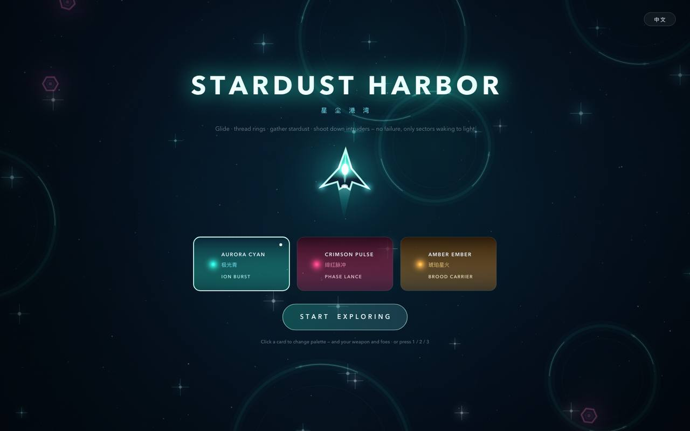
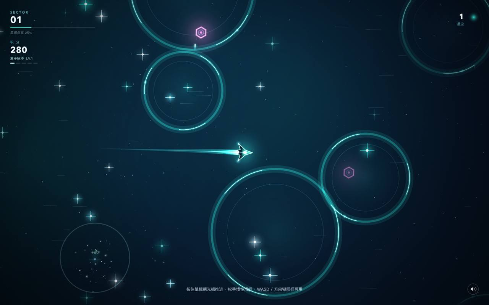
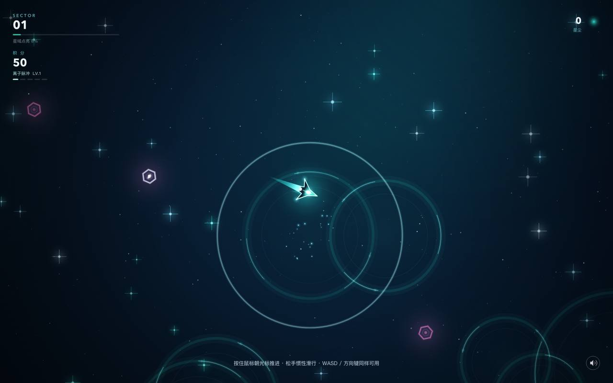

# Stardust Harbor

**English** | [中文](README.zh-CN.md)

A 2D sci-fi relaxation game that runs in one file. **No dependencies, no install, no network** — just open `index.html`.

> Glide · thread rings · gather stardust · shoot down intruders — no failure, only sectors waking to light.



---

## How to play

| Input | Action |
|---|---|
| Hold left mouse button | Thrust toward the cursor |
| Release | Coast on inertia (gentle damping, no hard stop) |
| `W A S D` / arrow keys | Keyboard thrust |
| `1` `2` `3` | Switch theme — which also switches your weapon and your foes |
| `L` | Switch language (中文 / English) |
| `M` | Mute / unmute |
| `P` / `Esc` | Pause / resume |
| `R` | Back to title (restart) |
| `Space` | Start from the title screen |

**Your weapon fires automatically** — you only have to fly beautifully. Where you go, what you gather, who you shoot is left to feel and a little luck.

### Goals
- **Gather stardust** — +10 points each, plus an ascending note (pentatonic, so chains turn into tunes).
- **Thread the rings** — fly into the hoop, +50 points.
- **Shoot down intruders** — 30 / 60 / 80 points depending on the foe; kills can drop extra stardust.
- Fill the bar to **46** to light a sector: +500 points, then the next sector begins. Endless loop, **no failure state and no health bar**.

---

## Three themes = three weapons + three foes

Switching theme swaps your weapon, your enemies, and the colour of the whole sector.

| Theme | Weapon | Feel | Foe |
|---|---|---|---|
| **AURORA CYAN** | **ION BURST** | Rapid bolts; the faster you fly, the faster it fires | Drifter — hex hull, tanky |
| **CRIMSON PULSE** | **PHASE LANCE** | Charges up, then fires a piercing beam through a whole line | Prism — splits into two smaller shards |
| **AMBER EMBER** | **BROOD CARRIER** | Never fires itself: launches escort gunships that orbit and engage | Swarm — fast and numerous |




### Higher score → stronger weapon

Crossing a score threshold upgrades the weapon automatically. The HUD shows five level pips, and a "LV.n + weapon name" banner flashes on each upgrade.

| Level | Score needed | Effect |
|---|---|---|
| LV.1 | 0 | Base form |
| LV.2 | 600 | Faster fire rate / charge |
| LV.3 | 1,600 | ION BURST twin shot; +1 beam damage; +1 drone |
| LV.4 | 3,200 | More damage and rate again |
| LV.5 | 5,600 | ION BURST triple shot; carrier runs a full wing of 6 |

Enemies cannot hurt you — there is no health and no game over. They approach, drift, and get shot down.

---

## Design notes

**Feel first (it is a relaxation game)**
- No health, no timer, no death; the only "penalty" is drifting while you coast.
- Inertia tuning: 980 px/s² acceleration, 1.35/s damping, 780 px/s cap — like gliding on ice.
- Generous pickup radii (stardust +30px, ring inner 86%) so a casual pass still rewards you.
- Auto-fire with predictive aim: enemies pop even if you never aim.

**Art — everything generated at runtime, zero assets**
- The probe is layered: gradient hull, inset armour plates, glowing core, engine flame, wingtip lights, ribbon trail.
- Each theme brings its own foe silhouette (hex / diamond / triangle) in a hue that contrasts with the palette, so friend and foe never blur together.
- Background: a baked base image, half-resolution nebula compositing upscaled 4×, three parallax star layers, and speed lines.
- Feedback: particle bursts, shockwaves, floating score numbers, screen bloom, sector-lit banner.

**Audio — synthesised live with Web Audio, no files**
- Bed: 55Hz fundamental plus five partials through a low-pass, breathing at 0.045Hz.
- Pickups: pentatonic ascending notes with three partials into a generated convolution reverb.
- Shots, explosions, the beam, and level-ups each get their own restrained voice.

**Performance**
- Base image and vignette are pre-baked; they only redraw on resize or palette change.
- Nebulae composite into a quarter-resolution canvas and get upscaled once, cutting fill-rate dramatically.
- Measured (Chrome headless, software rasteriser, 1440×900): 59.3 fps / p50 16.7 ms, against a 60 fps empty-canvas baseline in the same environment.
- Entities recycle by view radius and respawn just off-screen with a fade-in, keeping density stable.

---

## Files

```
index.html            # everything: HTML + CSS + JS (~2k lines), no external dependencies
README.md             # this file
README.zh-CN.md       # Chinese version
preview/              # screenshots
```

## Dev parameters (optional)

| Param | Effect |
|---|---|
| `?autostart` | Skip the title screen |
| `?palette=2` | Start with theme 2 (1 / 2 / 3) |
| `?lang=en` | Start in English (`zh` for Chinese) |

The page also exposes `window.__stardust` (state, player, input, audio, enemies, bullets, drones, `startGame()`, `setLang()`, …) for automated testing only.

## Browser support

Desktop browsers (current Chrome / Edge / Safari / Firefox). Uses Canvas 2D, Web Audio and Pointer Events; no build step.
