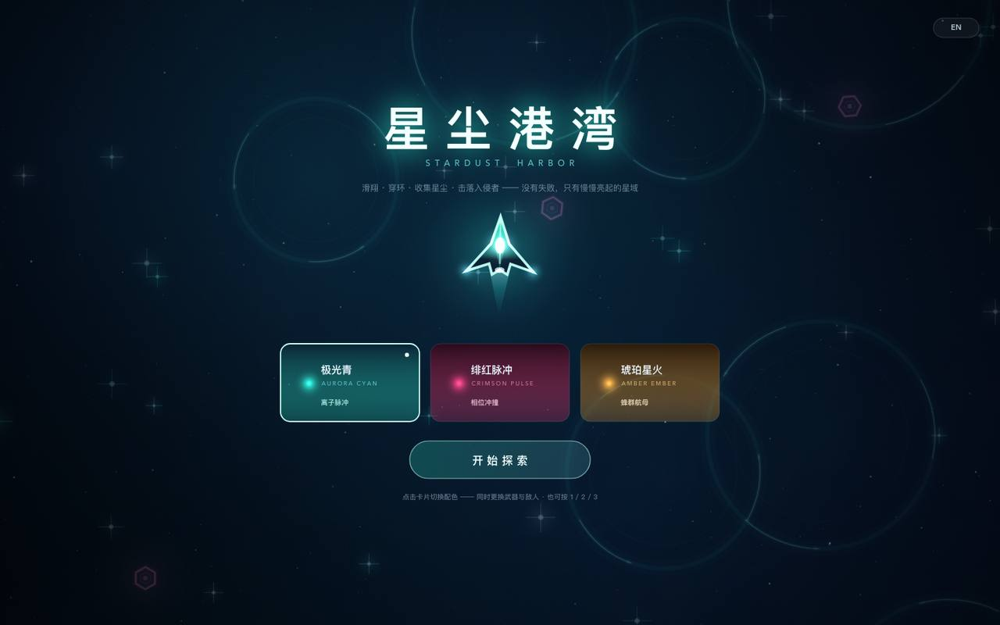

# 星尘港湾 · Stardust Harbor

[English](README.md) | **中文**

一个 2D 平面、科幻背景的休闲解压小游戏。**零依赖、零安装、零联网**——双击 `index.html` 即可玩。

> 滑翔 · 穿环 · 收集星尘 —— 没有失败，只有慢慢亮起的星域。



---

## 怎么玩

| 操作 | 说明 |
|---|---|
| 按住鼠标左键拖动 | 朝光标方向推进 |
| 松开鼠标 | 惯性滑行（带轻柔阻尼，不会急停） |
| `W A S D` / 方向键 | 键盘推进 |
| `1` `2` `3` | 切换配色（极光青 / 绯红脉冲 / 琥珀星火） |
| `L` | 切换语言（中文 / English） |
| `M` | 静音 / 取消静音 |
| `P` / `Esc` | 暂停 / 继续 |
| `R` | 回到标题（重新开始） |
| `空格` | 在标题页开始游戏 |

### 目标
- **收集星尘**：每颗星尘 +1 点亮进度，并奏出一个上行音（五声音阶，连着收集会自然成调）。
- **穿越星环**：飞进光环内部即可，每个星环 +3.5 进度，伴随冲击波与泛光。
- 进度满 **46** 即「星区点亮」，进入下一个星区，星域持续变亮。无限循环，**没有任何失败条件**。

---

## 设计要点

**玩法（解压优先）**
- 无血量、无倒计时、无死亡；唯一的"惩罚"是松手后慢慢滑行。
- 惯性手感：推进加速度 980 px/s²，阻尼 1.35/s，上限速度 780 px/s —— 类似冰面滑行。
- 收集判定宽松（星尘半径 +30px、星环内圈 86% 半径），随手滑过就有反馈。

**美术（全部程序化生成，无外部素材）**
- 探测器：分层渐变机身 + 内嵌装甲板 + 发光能量核 + 尾焰 + 翼尖灯 + 缎带式拖尾，三套配色可实时切换。
- 背景：烘焙底图 + 半分辨率星云合成（4× 上采样）+ 三层视差星野 + 速度线。
- 反馈：粒子爆发、星环冲击波、全屏泛光、星区点亮提示。

**音频（Web Audio 实时合成，无音频文件）**
- 环境铺底：55Hz 基频 + 5 个泛音通过低通滤波，0.045Hz 的缓慢呼吸。
- 收集音：五声音阶上行，三泛音叠加 + 程序生成的卷积混响。
- 穿环：大三和弦长音；星区点亮：上行琶音。

**性能**
- 背景底图 / 暗角预烘焙，仅窗口尺寸或配色变化时重绘。
- 星云在 1/4 分辨率画布合成后一次性放大叠加，大幅降低填充率。
- 实测（Chrome headless 纯软件光栅，1440×900）：59.3 fps / p50 16.7ms；同环境空场景基线 60 fps。
- 实体按视野半径回收，屏幕外环带重生并淡入，保证视野内密度稳定。

---

## 文件

```
index.html            # 全部内容：HTML + CSS + JS（约 1.6k 行），无外部依赖
README.md             # 英文说明
README.zh-CN.md       # 本文件（中文）
preview/              # 截图
```

## 开发用参数（可选）

URL 参数便于截图与调试：

| 参数 | 作用 |
|---|---|
| `?autostart` | 跳过标题页直接进入游戏 |
| `?palette=2` | 直接使用第二套配色启动 |
| `?lang=en` | 以英文启动（`zh` 为中文） |

页面还暴露了 `window.__stardust`（状态、玩家、输入、音频、实体数组、`startGame()`、`setLang()` 等），仅用于自动化测试，不影响正常玩法。

## 浏览器

面向桌面浏览器（Chrome / Edge / Safari / Firefox 现代版本）。使用 Canvas 2D、Web Audio、Pointer Events；无构建步骤。
