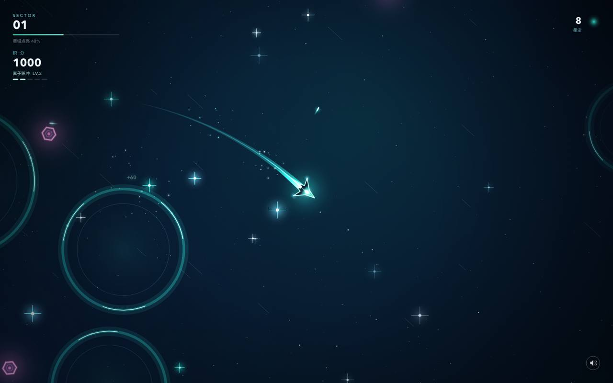
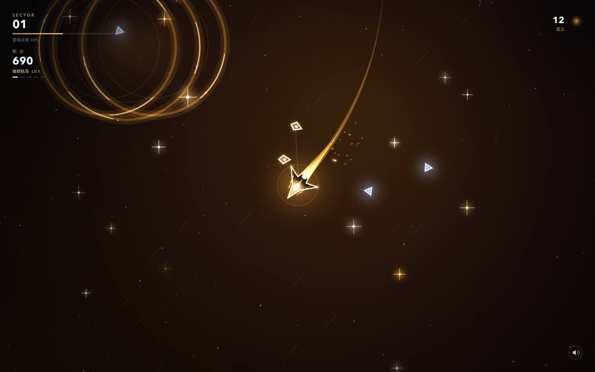

# 星尘港湾 · Stardust Harbor

[English](README.md) | **中文**

一个 2D 平面、科幻背景的休闲解压小游戏。**零依赖、零安装、零联网**——双击 `index.html` 即可玩。

> 滑翔 · 穿环 · 收集星尘 · 击落入侵者 —— 没有失败，只有慢慢亮起的星域。


---

## 怎么玩

| 操作 | 说明 |
|---|---|
| 按住鼠标左键拖动 | 朝光标方向推进 |
| 松开鼠标 | 惯性滑行（带轻柔阻尼，不会急停） |
| `W A S D` / 方向键 | 键盘推进 |
| `1` `2` `3` | 切换主题（同时更换武器与敌人） |
| `L` | 切换语言（中文 / English） |
| `M` | 静音 / 取消静音 |
| `P` / `Esc` | 暂停 / 继续 |
| `R` | 回到标题（重新开始） |
| `空格` | 在标题页开始游戏 |

**武器是自动开火的**——你只需要飞得漂亮。飞到哪里、收集什么、打谁，交给手感和一点运气。

### 目标
- **收集星尘**：每颗 +10 分，并奏出上行音（五声音阶，连着收集会自然成调）。
- **穿越星环**：飞进光环内部，+50 分。
- **击落入侵者**：每个敌人按体型给 30 / 60 / 80 分，击毁后可能掉落额外星尘。
- 进度条满 **46** 即「星区点亮」，+500 分，进入下一个星区。无限循环，**没有任何失败条件，也没有血量**。

---

## 三套主题 = 三种武器 + 三种敌人

切换主题会同时换掉你的武器、你的敌人和整个星域的色彩。

| 主题 | 武器 | 玩法特点 | 敌人 |
|---|---|---|---|
| **极光青** AURORA CYAN | **离子脉冲** ION BURST | 高速连射，速度越快射速越快——飞得猛就是输出高 | 游荡者（六角机身，皮厚） |
| **绯红脉冲** CRIMSON PULSE | **相位冲撞** PHASE RAM | 不开枪：加速、长刃、直接撞穿敌机；敌机刻意放得很稀，撞到一次才算数 | 棱镜（会分裂成两个小编队） |
| **琥珀星火** AMBER EMBER | **蜂群航母** BROOD CARRIER | 不直接开火；船体画大 1.8 倍、速度压慢，能看清小战舰绕着它护航 | 蜂群（数量多、速度快） |




### 绯红脉冲的冲撞怎么玩

把光标指得远一点，然后直线冲刺。探测器在红主题下**最快也最滑**（上限 889，青主题 780），
长直线能把速度攒住。速度过 **300 px/s** 时机首长出能量刃，HUD 显示「冲撞就绪」。
此时碰到敌机就是秒杀：**震屏 + 冲击环 + 火花 + `RAM +24` 飘字**，而且撞击会给你 +70 px/s 的动量，
越撞越快、可以一路连撞下去。速度不够时撞上去只是把敌机推开——那就再加速。

### 分数越高，武器越强

积分跨过阈值就自动升级，HUD 下方有 5 格等级指示，升级时屏幕中央会亮出「LV.n 武器名」。

| 等级 | 需要分数 | 效果 |
|---|---|---|
| LV.1 | 0 | 基础形态 |
| LV.2 | 800 | 射速提升 |
| LV.3 | 2,200 | 离子脉冲双发；小战舰 +1 |
| LV.4 | 4,200 | 弹数与护航机再提升 |
| LV.5 | 7,000 | 离子脉冲三发齐射；航母满编 6 架 |

敌人不会伤害你（没有血量、没有 Game Over），它们只会靠近、游荡、被击落。

---

## 设计要点

**玩法（解压优先）**
- 无血量、无倒计时、无死亡；唯一的"惩罚"是松手后慢慢滑行。
- 惯性手感：推进加速度 980 px/s² + 指数阻尼，类似冰面滑行；三套主题各有自己的上限、阻尼与船体尺寸：极光青 780 / 1.35（1.18 倍）、绯红脉冲 889 / 1.12（1.08 倍）、琥珀星火 655 / 1.52（1.82 倍，真是艘又大又慢的航母）。
- 敌机密度也按主题区分：绯红脉冲刻意稀疏（第 1/2/3 星区只有 2/3/4 架，其它主题是 5/6/7 架），撞到才有分量。
- 收集判定宽松（星尘半径 +30px、星环内圈 86% 半径），随手滑过就有反馈。
- 自动开火 + 提前量瞄准：不用瞄准也能看着敌人一个个炸开。

**美术（全部程序化生成，无外部素材）**
- 探测器：分层渐变机身 + 内嵌装甲板 + 发光能量核 + 尾焰 + 翼尖灯 + 缎带式拖尾。
- 敌人按主题换造型（六角 / 菱形 / 三角），并用与主题对比的色相，保证一眼能分清敌我。
- 背景：烘焙底图 + 半分辨率星云合成（4× 上采样）+ 三层视差星野 + 速度线。
- 反馈：粒子爆发、冲击波、分数飘字、全屏泛光、星区点亮提示。

**音频（Web Audio 实时合成，无音频文件）**
- 环境铺底：55Hz 基频 + 5 个泛音通过低通滤波，0.045Hz 的缓慢呼吸。
- 收集音：五声音阶上行，三泛音叠加 + 程序生成的卷积混响。
- 射击 / 爆炸 / 激光 / 升级各自合成，音色各不相同且音量克制。

**性能**
- 背景底图、暗角预烘焙，仅在窗口尺寸或主题变化时重绘。
- 星云在 1/4 分辨率画布合成后一次性放大叠加，大幅降低填充率。
- 实测（Chrome headless 纯软件光栅，1440×900）：59.3 fps / p50 16.7ms；同环境空场景基线 60 fps。
- 实体按视野半径回收，屏幕外环带重生并淡入，保证视野内密度稳定。

---

## 文件

```
index.html            # 全部内容：HTML + CSS + JS（约 2.4k 行），无外部依赖
py/combat_model.py    # 战斗机制的 Python 参考模型（不参与运行）
README.md             # 英文说明
README.zh-CN.md       # 本文件（中文）
preview/              # 截图
```

## Python 机制参考模型

`py/combat_model.py` 把速度、阻尼、等级门槛、开火间隔、冲撞判定与奖励、护航机数量等数值
抽成一组小函数，并直接打印成表格，方便阅读和试算：

```bash
python3 py/combat_model.py
```

它只是"说明书"，不参与构建；改它不会改变游戏，确认手感后把数值同步回 `index.html` 即可。

## 开发用参数（可选）

URL 参数便于截图与调试：

| 参数 | 作用 |
|---|---|
| `?autostart` | 跳过标题页直接进入游戏 |
| `?palette=2` | 直接以第二套主题启动（1 / 2 / 3） |
| `?lang=en` | 以英文启动（`zh` 为中文） |

页面还暴露了 `window.__stardust`（状态、玩家、输入、音频、敌人、子弹、无人机、`startGame()`、`setLang()` 等），仅用于自动化测试，不影响正常玩法。

## 浏览器

面向桌面浏览器（Chrome / Edge / Safari / Firefox 现代版本）。使用 Canvas 2D、Web Audio、Pointer Events；无构建步骤。
